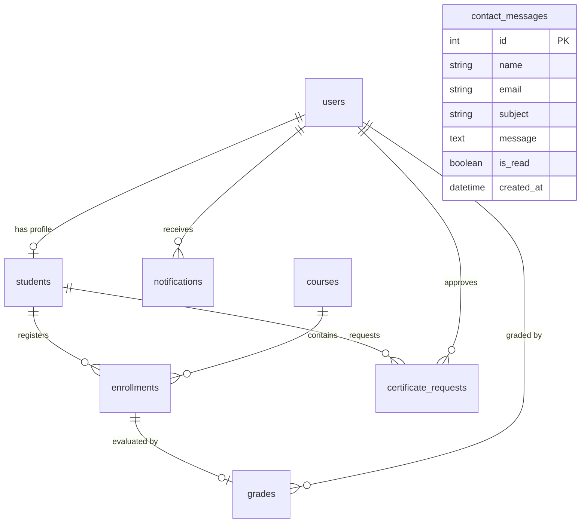

# UniConnect &mdash; Monolithic University Management System

[](https://www.php.net/)
[](https://www.mysql.com/)
[](https://getbootstrap.com/)
[]()

**UniConnect** is a fully functional, enterprise-grade university management web application developed strictly using a **Monolithic Architecture**. Developed with native PHP, MySQL, and Bootstrap 5, UniConnect unifies student self-service enrollment, academic record tracking, weighted gradebook evaluation, official certificate issuance, and comprehensive administrative oversight into one cohesive, single-codebase portal.

---

## Table of Contents
1. [Project Overview & Architecture](#project-overview--architecture)
2. [Technology Stack](#technology-stack)
3. [XAMPP Installation & Execution Guide](#xampp-installation--execution-guide)
4. [Demo Accounts & Credentials](#demo-accounts--credentials)
5. [Directory & File Structure](#directory--file-structure)
6. [Complete Pages & Functionality Map](#complete-pages--functionality-map)
7. [Database Schema (`uniconnect_db`)](#database-schema-uniconnect_db)
8. [Comprehensive Testing Checklist & Expected Results](#comprehensive-testing-checklist--expected-results)
9. [Security & Architectural Highlights](#security--architectural-highlights)

---

## 1. Project Overview & Architecture

UniConnect adopts a pure **Monolithic Architecture**:
- **Single Integrated Application**: All frontend presentation layers, server-side business logic, role-based authentication, session states, and database persistence layers live inside one cohesive project tree.
- **No Microservices or External APIs**: No microservice fragmentation, cross-origin API tokens, or external middleware. Everything executes natively through PHP and MySQL under Apache.
- **Relational Integrity**: Built on a normalized MySQL schema (`uniconnect_db`) with foreign key constraints, cascading delete safety, and multi-column unique constraints preventing duplicate course enrollments.

---

## 2. Technology Stack

- **Backend**: Native PHP 8.0+ (Tested on PHP 8.2.12; Object-Oriented / Procedural monolithic clean structure; no Laravel or third-party PHP frameworks).
- **Database Layer**: MySQL / MariaDB via PHP Data Objects (`PDO`) with prepared statements and parameter binding.
- **Frontend**: HTML5, CSS3, JavaScript (ES6+), Bootstrap 5.3.3, and FontAwesome 6.5.1.
- **Local Development Environment**: XAMPP (Apache web server & MySQL database server on Windows).

---

## 3. XAMPP Installation & Execution Guide

Follow these steps to set up and run UniConnect locally:

### Step 1: Place the Project in XAMPP `htdocs`
Make sure the application folder is placed in:
```text
C:\xampp\htdocs\UniConnect
```
The application URL will be:
```text
http://localhost/UniConnect/
```

### Step 2: Start Apache and MySQL in XAMPP
1. Open the **XAMPP Control Panel** (`C:\xampp\xampp-control.exe`).
2. Click **Start** for **Apache**.
3. Click **Start** for **MySQL**.
4. Both services should display green status lights.

### Step 3: Database Initialization (Two Easy Methods)

#### Method A: 1-Click Browser Installer (Recommended)
UniConnect features an automatic diagnostic and installer script:
1. Open your browser and navigate to:
   ```text
   http://localhost/UniConnect/install.php
   ```
2. Click the **"Initialize Database Now"** button.
3. The script will automatically connect to MySQL, create the `uniconnect_db` database, execute all table schemas, and populate all demo users, courses, enrollments, and grades.

#### Method B: Manual Import via phpMyAdmin
1. Open your browser and go to `http://localhost/phpmyadmin/`.
2. Click **Databases** and create a new database named `uniconnect_db` (Collation: `utf8mb4_unicode_ci`).
3. Select `uniconnect_db` in the left panel.
4. Click the **Import** tab at the top.
5. Click **Choose File** and select `C:\xampp\htdocs\UniConnect\uniconnect_db.sql`.
6. Click **Import** (or **Go**) at the bottom.

### Step 4: Access the Application
Open your web browser and navigate to:
```text
http://localhost/UniConnect/
```

---

## 4. Demo Accounts & Credentials

The database comes pre-seeded with ready-to-test accounts. The login screen also features **1-Click Demo Fill buttons** for rapid evaluation!

| Role | Name | Email / Identifier | Password | Access / Notes |
| :--- | :--- | :--- | :--- | :--- |
| **Administrator** | System Administrator | `admin@uniconnect.edu` | `admin123` | Full administrative control: students, courses, enrollments, grades, certificates, inquiries. |
| **Student (Demo 1)** | Johnathan Doe | `john.doe@uniconnect.edu` *(or `STD2024001`)* | `student123` | Junior, Computer Science &bull; 4 active courses, grades recorded, approved certificate. |
| **Student (Demo 2)** | Sarah Jenkins | `sarah.j@uniconnect.edu` *(or `STD2024002`)* | `student123` | Sophomore, Software Engineering &bull; Enrolled in 3 courses. |
| **Student (Demo 3)** | Michael Chen | `m.chen@uniconnect.edu` *(or `STD2024003`)* | `student123` | Senior, Information Technology &bull; Enrolled in 4 courses. |
| **Student (Demo 4)** | Emily Watson | `emily.w@uniconnect.edu` *(or `STD2024004`)* | `student123` | Freshman, Computer Science &bull; Enrolled in 2 courses. |
| **Student (Demo 5)** | Alex Rivera | `alex.r@uniconnect.edu` *(or `STD2024005`)* | `student123` | Sophomore, Data Science &bull; Enrolled in 3 courses. |

*You can also register a brand new student via the public registration page (`auth/register.php`).*

---

## 5. Directory & File Structure

```text
C:\xampp\htdocs\UniConnect\
│
├── config/
│   ├── database.php            # PDO database connection, credentials, and error handlers
│   └── config.php              # Global session management, app constants, dynamic base URL
│
├── includes/
│   ├── auth.php                # Authentication guards (require_login, require_admin, require_student)
│   ├── functions.php           # Sanitization, flash messages, CSRF, GPA & grading calculators
│   ├── header.php              # Shared HTML head, navigation topbar, notifications dropdown
│   ├── sidebar.php             # Role-aware responsive sidebar (Admin vs Student modules)
│   ├── footer.php              # Shared portal footer, Bootstrap JS bundle, main.js
│   └── alerts.php              # Reusable flash alert notifications rendering component
│
├── auth/
│   ├── login.php               # Multi-role authentication with demo auto-fill shortcuts
│   ├── register.php            # Student self-registration with automatic student ID generation
│   └── logout.php              # Secure session destruction and redirect
│
├── admin/
│   ├── dashboard.php           # Executive metrics, recent student list, pending cert alerts, charts
│   ├── students.php            # Student directory with search, department & level filters
│   ├── student-add.php         # Form to add new students with identity and academic placement
│   ├── student-edit.php        # Update student details, contact info, status, and password reset
│   ├── student-delete.php      # Safe deletion handler with cascade deletion confirmation
│   ├── courses.php             # Course catalog management with search, department filter, capacity
│   ├── course-add.php          # Add curriculum course with credits, instructor, capacity limit
│   ├── course-edit.php         # Edit course title, credits, term, instructor, and description
│   ├── course-delete.php       # Delete course with cascade confirmation
│   ├── enrollments.php         # Manage student rosters, manual admin enrollments, drop enrollments
│   ├── grades.php              # Record assessment marks, live grade calculation, class statistics
│   ├── certificates.php        # Review, approve, reject, or complete student certificate requests
│   └── messages.php            # Inbox for public contact form inquiries with mark-as-read
│
├── student/
│   ├── dashboard.php           # Student overview: GPA, credits, courses, graduation progress bar
│   ├── courses.php             # University catalog: browse & enroll with capacity & duplicate check
│   ├── my-courses.php          # List of active semester courses with drop course option
│   ├── grades.php              # Official academic transcript: score breakdown, GPA, print layout
│   ├── certificates.php        # Request new official certificates, view request history and status
│   ├── certificate-view.php    # Official printable certificate document with university seal & signature
│   ├── profile.php             # View student records, update contact details, change password
│   └── notifications.php       # Activity notification feed with "Mark all as read"
│
├── assets/
│   ├── css/
│   │   └── style.css           # Academic portal styling, responsive layout, print stylesheet
│   ├── js/
│   │   └── main.js             # Mobile sidebar toggle, live grade calculation, demo fillers
│   └── img/
│       └── logo.svg            # Crisp SVG university crest / emblem
│
├── index.php                   # Public landing page: hero, features, departments, working contact form
├── install.php                 # 1-Click database installation & diagnostic utility
├── uniconnect_db.sql           # Complete relational schema and rich sample dataset
└── README.md                   # Detailed setup, architecture, and testing documentation
```

---

## 6. Complete Pages & Functionality Map

### Public & Authentication Pages
1. **University Landing Page (`index.php`)**:
   - Institutional overview, academic departments showcase, key statistics.
   - Fully functional contact form storing inquiries directly into `contact_messages` and alerting the admin.
2. **Database Installer (`install.php`)**:
   - One-click server diagnostic and database migration runner for XAMPP.
3. **Login Portal (`auth/login.php`)**:
   - Authenticates using either email address or Student ID code.
   - Direct 1-click evaluator demo buttons (`Admin Demo` / `Student Demo`).
4. **Student Registration (`auth/register.php`)**:
   - Self-service enrollment form.
   - Automatically generates a unique Student ID (e.g., `STD2024006`), securely hashes passwords with bcrypt, provisions initial student record, and creates a welcome notification.
5. **Logout (`auth/logout.php`)**:
   - Clears session cookies, invalidates session data, and redirects with a flash notification.

### Student Portal (`/student/`)
1. **Student Dashboard (`dashboard.php`)**:
   - Personalized welcome banner with major, level, and semester.
   - Metric cards: Active Courses, Cumulative GPA (out of 4.0), Total Earned Credits, Pending Requests.
   - Enrolled courses roster with live grade badges.
   - Graduation credit completion progress bar (based on 120 credit requirement).
   - Recent certificate request status monitor.
2. **Course Catalog & Enrollment (`courses.php`)**:
   - Browse all university courses with department filters and text search.
   - Real-time seat availability indicator (`enrolled / capacity`).
   - "Enroll" action:
     - Validates class capacity.
     - Enforces duplicate enrollment prevention (rejects if already enrolled in the same term).
     - Generates enrollment record and initial placeholder grade entry.
     - Dispatches real-time student notification.
3. **My Enrolled Courses (`my-courses.php`)**:
   - View courses registered for current semester.
   - "Drop Course" action with confirmation dialog.
4. **Academic Transcript & Grades (`grades.php`)**:
   - Cumulative GPA summary and earned credit hours.
   - Full assessment breakdown per course: Assignment (20%), Midterm (30%), Final Exam (50%), Total Score, Letter Grade, GPA Points, and Instructor Remarks.
   - Grading scale reference table.
   - "Print Transcript" button formatted for clean printing.
5. **Certificate & Document Requests (`certificates.php`)**:
   - Modal to request: *Enrollment Verification*, *Official Academic Transcript*, *Degree Completion Certificate*, *Recommendation Letter*, *Good Conduct Certificate*, *English Proficiency Certificate*.
   - Delivery options: Digital Online Document or Physical Registrar Pickup.
   - History table displaying Reference # (`UC-CERT-YYYY-XXXX`), submission date, status badge, and registrar remarks.
   - For approved requests, instant access to view/print the official document.
6. **Printable Official Certificate (`certificate-view.php`)**:
   - Verified academic document layout with University Seal, official declaration statement, cumulative GPA, registrar remarks, date of issuance, and official signature line.
   - Includes dedicated `@media print` CSS for saving as PDF or printing.
7. **Profile Management (`profile.php`)**:
   - View official student record details.
   - Update contact details (phone, date of birth, residential address).
   - Change password with current password verification.
8. **Notification Center (`notifications.php`)**:
   - Timeline of all personal activity alerts with timestamp and action links.
   - "Mark all as read" capability.

### Administrator Portal (`/admin/`)
1. **Admin Dashboard (`dashboard.php`)**:
   - Aggregate statistics: Total Students, Active Courses, Total Enrollments, Pending Certificates, Unread Inquiries.
   - Recent student registrations table.
   - Urgent action widget for pending certificate requests.
   - Breakdown of students by academic department.
2. **Student Directory (`students.php`)**:
   - Complete list of registered students with search by name/ID/email and filters by department and academic year.
   - Action buttons for editing and deleting records.
3. **Add Student (`student-add.php`)**:
   - Administrator creation of student accounts with automatic/custom Student ID, department placement, credentials, and welcome alert.
4. **Edit Student (`student-edit.php`)**:
   - Modify personal details, department, semester, contact info, account status (`active` / `inactive`), and optional administrative password reset.
5. **Delete Student (`student-delete.php`)**:
   - Safely removes student user account; relational database constraints automatically cascade and remove associated enrollments, grades, and requests.
6. **Course Management (`courses.php`)**:
   - Curriculum catalog with department filters, credit values, instructor names, enrolled capacity counts, and active/inactive toggles.
7. **Add Course (`course-add.php`)**:
   - Add new course with code, title, department, credits (1-6), semester, instructor, max capacity, and syllabus description.
8. **Edit Course (`course-edit.php`)**:
   - Update course syllabus, instructor, capacity, or status.
9. **Delete Course (`course-delete.php`)**:
   - Deletes course and associated enrollments with confirmation.
10. **Enrollment Management (`enrollments.php`)**:
    - Comprehensive roster across all courses.
    - Manual administrative enrollment modal: allows enrolling any student into any active course with automatic capacity and duplicate checks.
    - Ability to drop or remove an enrollment.
11. **Grades Management (`grades.php`)**:
    - Grade assignment interface filtered by course or student.
    - Class statistics widget showing class average score, course GPA average, and top score.
    - Interactive grading modal:
      - Real-time client-side calculation of weighted total, letter grade, and GPA points as marks are typed.
      - Updates `grades` table, sets `graded_by` and `graded_at`.
      - Automatically dispatches an in-app grade posted notification to the student.
12. **Certificate Requests Review (`certificates.php`)**:
    - Filter requests by status: All, Pending, Approved, Rejected.
    - Review modal: update status to `approved`, `rejected`, or `completed` and attach registrar verification remarks.
    - Automatically updates student notification and enables printable certificate generation.
13. **Contact Inquiries Inbox (`messages.php`)**:
    - Review messages sent via the public website contact form.
    - Mark as read or delete inquiries.

---

## 7. Database Schema (`uniconnect_db`)

The relational database comprises 8 normalized tables with foreign keys and indexes:



### Table Breakdown:
1. **`users`**: Base authentication table storing `name`, `email`, `password` (bcrypt), `role` (`admin`, `student`), and `status` (`active`, `inactive`).
2. **`students`**: Academic profile linked 1-to-1 to `users.id` on delete cascade; holds `student_id` (unique code), `department`, `academic_year`, `semester`, `phone`, `date_of_birth`, and `address`.
3. **`courses`**: Academic catalog storing `course_code` (unique), `course_name`, `department`, `credits`, `semester`, `instructor_name`, `max_capacity`, and `status`.
4. **`enrollments`**: Junction table between `students` and `courses`. Contains a multi-column unique key on `(student_id, course_id, semester)` strictly enforcing duplicate enrollment prevention.
5. **`grades`**: Academic assessments linked 1-to-1 with `enrollments.id`. Stores `assignment_score`, `midterm_score`, `final_score`, `total_score`, `letter_grade`, `grade_point`, `remarks`, and `graded_by`.
6. **`certificate_requests`**: Official document submissions linked to `students.id`. Stores `certificate_type`, `purpose`, `delivery_type`, `status`, `reference_no`, `admin_remarks`, and `processed_by`.
7. **`notifications`**: In-app notifications linked to `users.id`. Stores `title`, `message`, `type`, `link`, `is_read`, and `created_at`.
8. **`contact_messages`**: Public website inquiries storing `name`, `email`, `subject`, `message`, `is_read`, and `created_at`.

---

## 8. Comprehensive Testing Checklist & Expected Results

Use this checklist to verify each functional requirement:

| Test ID | Test Scenario | Steps to Execute | Expected Result | Status |
| :---: | :--- | :--- | :--- | :---: |
| **TC-01** | **Database Initialization** | Navigate to `http://localhost/UniConnect/install.php` and click "Initialize Database Now". | Green success alert appears; tables and sample data populated. | Pass |
| **TC-02** | **Admin Login** | Open `auth/login.php`, click "Admin Demo" (or enter `admin@uniconnect.edu` / `admin123`), click Sign In. | Successfully logged in and redirected to `admin/dashboard.php`. | Pass |
| **TC-03** | **Student Login** | Log out, open `auth/login.php`, click "Student Demo" (or enter `john.doe@uniconnect.edu` / `student123`), click Sign In. | Successfully logged in and redirected to `student/dashboard.php`. | Pass |
| **TC-04** | **Student Self-Registration** | Go to `auth/register.php`, complete all fields with a new email, submit form. | Student account created with auto-generated ID (e.g. `STD2024006`), automatically logged in to student dashboard. | Pass |
| **TC-05** | **Role Authorization Guard** | While logged in as a student, attempt to manually navigate to `admin/dashboard.php`. | Blocked from admin panel; redirected with alert "Access denied. Administrator privileges are required." | Pass |
| **TC-06** | **Course Catalog & Duplicate Prevention** | As student, open `student/courses.php`, click "Enroll" on an already enrolled course. | Prevented from duplicate enrollment with warning message. | Pass |
| **TC-07** | **New Course Enrollment** | As student, click "Enroll in Course" on an active course not yet taken. | Successfully enrolled, course appears under `student/my-courses.php`, confirmation notification created. | Pass |
| **TC-08** | **Drop Course** | In `student/my-courses.php`, click "Drop" on an enrolled course and confirm. | Course status updated to dropped and removed from active schedule. | Pass |
| **TC-09** | **Academic Transcript & GPA** | Navigate to `student/grades.php`. | Displays all course assessments, weighted totals, letter grades, and calculated cumulative GPA (3.82). | Pass |
| **TC-10** | **Certificate Request Submission** | Go to `student/certificates.php`, click "New Document Request", select "Official Academic Transcript", submit. | Request created with unique reference code (e.g. `UC-CERT-2024-XXXX`), status marked as Pending. | Pass |
| **TC-11** | **Admin Student Management** | As admin, go to `admin/students.php`, use search bar and department filter, add a student, edit a student. | Table updates instantly; edits reflect immediately in database. | Pass |
| **TC-12** | **Admin Course Management** | In `admin/courses.php`, click "Add New Course", fill in details, submit. | Course created and immediately visible in student catalog. | Pass |
| **TC-13** | **Admin Grade Assignment** | In `admin/grades.php`, click "Assign/Edit" on a student enrollment, enter marks (Assignment: 95, Midterm: 90, Final: 92), save. | Calculated total (92.00%) and letter grade (A) saved; notification sent to student. | Pass |
| **TC-14** | **Admin Certificate Approval** | In `admin/certificates.php`, click "Review" on a pending request, change status to "Approve Document", add remarks, save. | Status updated to Approved; notification sent to student. | Pass |
| **TC-15** | **Printable Certificate Document** | Click "View / Print" on an approved certificate in `student/certificates.php`. | Displays printable official certificate with university seal, reference code, GPA statement, and print button. | Pass |
| **TC-16** | **Homepage Contact Form** | Go to `index.php#contact`, fill out the inquiry form, submit. | Message stored in `contact_messages`; visible in `admin/messages.php`; admin notification generated. | Pass |
| **TC-17** | **Logout Security** | Click user dropdown and select "Log Out". | Session destroyed, cookies cleared, redirected to login page with success notification. | Pass |

---

## 9. Security & Architectural Highlights

- **SQL Injection Prevention**: 100% of database interactions utilize prepared statements with parameter binding via PHP's PDO extension.
- **Cross-Site Scripting (XSS) Mitigation**: All user-supplied output rendered in HTML views is sanitized via `htmlspecialchars($string, ENT_QUOTES, 'UTF-8')` through the global `e()` helper function.
- **Cross-Site Request Forgery (CSRF) Protection**: Dynamic session tokens generated via cryptographically secure pseudo-random bytes (`random_bytes(32)`) and validated using constant-time comparison (`hash_equals`).
- **Session Security**: Active session IDs are regenerated upon successful authentication (`session_regenerate_id(true)`) to mitigate session fixation attacks.
- **Password Security**: Passwords are saved strictly using the industry-standard `PASSWORD_BCRYPT` algorithm with dynamic salting.
- **Clean Monolithic Routing**: Relative base path detection automatically resolves script paths regardless of whether the project is deployed directly in web root or in a subfolder like `/UniConnect/`.

---

**Developed for Academic Excellence &bull; UniConnect Monolithic University Portal**
